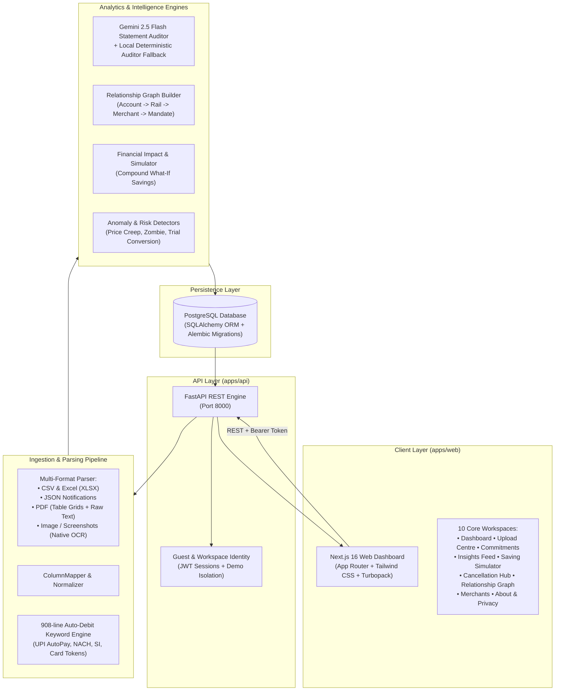
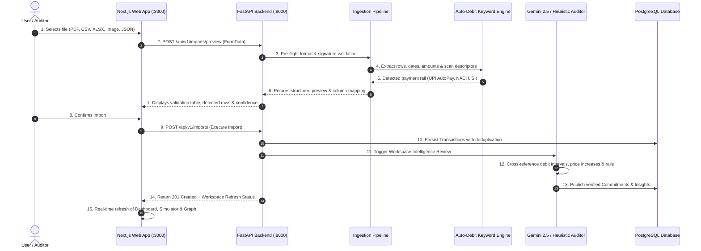

# PayScope: Complete End-to-End Workflow & Architecture Guide

PayScope is an AI-powered recurring payment intelligence and auto-debit audit platform designed to analyze bank statements, credit card bills, and payment notification feeds. It detects recurring subscriptions, verifies mandates (UPI AutoPay, NACH/e-Mandate, Standing Instructions), flags price creep and zombie charges, simulates financial savings, and provides one-click cancellation playbooks.

---

## 1. High-Level Architecture Overview

PayScope is structured as a modern decoupled full-stack application:



---

## 2. Complete Step-by-Step Data Flow



---

## 3. Core Modules & Their Functionality

### 3.1 Upload Centre & Ingestion Pipeline (`apps/api/app/ingestion/`)
- **Supported Formats**:
  - **CSV & Excel (XLSX)**: Parses structured statements and tabular exports.
  - **JSON**: Ingests automated payment notification feeds and webhook payloads.
  - **PDF Statements (`pdf_parser.py`)**:
    - *Tier 1*: Extracts ruled table cells via `pdfplumber`.
    - *Tier 2*: Selectable raw text extraction with regex parsing (`RawTextStatementParser`).
    - *Tier 3*: Scanned image PDF fallback using Windows Native OCR (`winocr`).
  - **Image / Screenshot Uploads (`image_parser.py`)**:
    - Directly accepts `.png`, `.jpg`, `.jpeg`, and `.webp` statement screenshots.
    - Uses local OCR to convert pixels to structured transaction lines.
- **Pre-Flight Validation (`file_validator.py`)**: Checks MIME types, magic bytes, file size limits (10 MB), and enforces the synthetic testing constraint.
- **Deduplication**: SHA-256 idempotency checking ensures re-uploading the same statement never creates duplicate debit records.

### 3.2 Auto-Debit Keyword Intelligence (`autodebit_keyword_service.py`)
Loaded from a dedicated 908-line dictionary (`payscope_autodebit_keywords.json`):
- **Payment Rail Detection**:
  - `UPI AutoPay`: UMN, UPI Mandate, UPI SI, OTM, Recurring UPI.
  - `NACH / ECS / e-Mandate`: UMRN, National Automated Clearing House, Direct Debit.
  - `Standing Instructions (SI)`: Bank auto-transfer, scheduled debit.
  - `Card Recurring Token`: Tokenized recurring debit on Visa/Mastercard/RuPay.
  - `EMI / Loan`: Auto-clearing loan installments.
- **Signal Filtering**: Identifies and separates failure keywords (`REVERSAL`, `BOUNCE`, `FAILED`) from genuine successful debits.

### 3.3 AI Financial Statement Auditor (`ai_review.py`)
- **Primary Engine**: Google Gemini 2.5 Flash via structured JSON schema output.
- **Deterministic Heuristic Fallback**: An offline auditor that guarantees 100% platform availability even without an external API key or network connectivity.
- **Verification Rules**:
  - Requires at least 2 distinct cycles observed on distinct calendar dates.
  - Enforces cadence bounds: weekly (5–10 days), monthly (25–35 days), quarterly (75–105 days), annual (330–400 days).
  - Flags **Price Creep** (e.g. Netflix raising plan from ₹499 to ₹649).
  - Flags **Zombie Subscriptions** (services recurring continuously with zero engagement).
  - Flags **Trial Conversions** (initial zero or token charge transitioning to full price).

### 3.4 Executive Dashboard (`apps/web/src/app/dashboard/`)
- **Key Metrics (KPIs)**:
  - Total Monthly Recurring Outflow (e.g., ₹8,450/month).
  - Annualized Recurring Outflow.
  - Active vs. Candidate mandate counts.
  - Period-over-period spend variance.
- **Top Merchants Outflow**:
  - Visual ranking of top merchants with branded company logos.
  - Plain-language labels: uses **Period** instead of obscure technical jargon like "cadence".
  - Breakdown by payment channels (UPI, NACH, Card).

### 3.5 Saving Simulator (`apps/web/src/app/financial-impact/` & `savings/`)
- **Plain-English What-If Modeling**:
  - Designed for everyday users without confusing financial acronyms.
  - Toggle switches to test: *"What happens if I stop Netflix and Gym?"*
  - Interactive sliders calculating:
    - Monthly money saved.
    - 1-Year bank balance boost.
    - 3-Year wealth impact assuming 7% safe return.
    - Equivalent months of emergency fund created.

### 3.6 One-Click Cancellation Playbooks (`apps/web/src/app/cancellations/`)
- **Step-by-Step Cancellation Workflows**:
  - **UPI AutoPay**: Step-by-step instructions for Google Pay, PhonePe, and Paytm (Profile → Autopay → Cancel Mandate).
  - **NACH / e-Mandate**: NetBanking portal steps under RBI e-Mandate circular guidelines.
  - **Credit Card SI**: Bank app card management token revoke steps.
  - **Merchant Portal**: Direct links to account settings pages.
- **Auto-Drafted Formal Cancellation Emails**:
  - Pre-fills customer name, mandate reference (UMN/UMRN), date, and amount.
  - Copies ready-to-send cancellation notice with legal backing under consumer regulations.

### 3.7 Relationship Knowledge Graph (`apps/web/src/app/relationships/`)
- Interactive node-link visualization mapping the complete financial topology:
  $$\text{Bank Account} \longrightarrow \text{Payment Rail} \longrightarrow \text{Merchant} \longrightarrow \text{Mandate} \longrightarrow \text{Risk Alerts}$$
- Allows users to visually see which bank accounts hold high-risk or inactive subscriptions.

---

## 4. Complete Frontend Sitemap

| Route | Page Name | Primary Purpose |
| :--- | :--- | :--- |
| `/` | Landing / Hero | Value proposition, feature highlights, quick-start guide |
| `/dashboard` | Executive Dashboard | Outflow KPIs, top merchants with logos, distribution charts |
| `/upload` | Upload Centre | Ingest CSV, XLSX, JSON, PDF (tables & raw text), and image screenshots |
| `/commitments` | Recurring Commitments | Manage discovered subscriptions, confirm candidates, edit status |
| `/insights` | Financial Intelligence | Price increase alerts, zombie charges, trial conversions |
| `/financial-impact` | Saving Simulator | Simple what-if savings simulator and compound wealth forecast |
| `/cancellations` | Cancellation Hub | Cancellation guides (UPI, NACH, Card) and auto-drafted notices |
| `/relationships` | Knowledge Graph | Interactive network graph connecting rails, merchants, and mandates |
| `/merchants` | Merchant Directory | Normalized merchant profiles and categorization |
| `/about` | About PayScope | Mission, technology stack, and privacy guarantees |
| `/privacy` | Privacy Policy | Local-first processing and synthetic data protection policy |

---

## 5. Backend REST API Reference

```
Authentication & Identity:
  POST /api/v1/auth/guest           Create guest session token
  GET  /api/v1/auth/me              Retrieve workspace identity

Ingestion & Files:
  POST /api/v1/imports/preview      Parse & preview upload (CSV, XLSX, PDF, Image, JSON)
  POST /api/v1/imports              Commit import & trigger AI workspace refresh
  GET  /api/v1/imports              Fetch past import history and audit logs
  GET  /api/v1/demo/sample-files    Download pre-configured synthetic test files

Analytics & Dashboard:
  GET  /api/v1/dashboard/summary    Outflow KPIs, top merchants, category breakdown
  GET  /api/v1/commitments          List all discovered recurring commitments
  POST /api/v1/commitments/{id}/decide User action: confirm, pause, ignore
  GET  /api/v1/insights             Feed of detected price creep, zombies, and alerts
  GET  /api/v1/financial-impact/summary Financial metrics and emergency runway
  POST /api/v1/savings/simulate     What-if calculation for selected cancellations
  GET  /api/v1/cancellations        Step-by-step playbooks and mandate cancellation drafts
  GET  /api/v1/graph                Nodes and edges for the financial relationship graph
  GET  /api/v1/health               System health status and version check
```

---

## 6. Security, Reliability & Privacy Guardrails

1. **Local-First Processing**: All statement parsing (including image OCR and raw text regex matching) executes locally on the user's host machine.
2. **Zero Hard Failure Fallback**: If the external Gemini API is unreachable or rate-limited, PayScope activates its deterministic keyword auditor, ensuring zero 500 errors.
3. **Idempotent Ingestion**: SHA-256 hashing prevents double-counting or re-importing identical files.
4. **Data Isolation**: Multi-tenant workspace keys isolate each user's financial graph and commitments.
