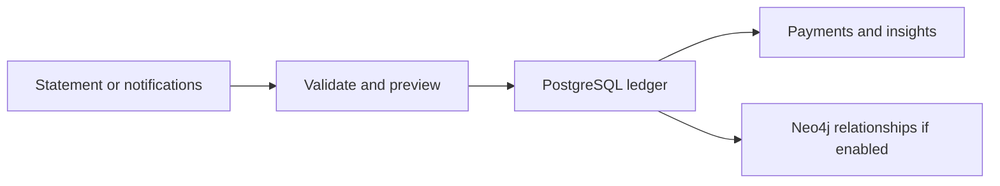

# PayScope

PayScope turns bank statement exports into a review of recurring payments. It shows which charges repeat, what changed between statements, and where to go if you want to cancel.

Designed by **Vinay Bhadane** and **Sakshi Patil** at **MET Institute of Engineering, Nashik**.

[Open PayScope](https://payscope-web.onrender.com) · [Download the Android APK](https://payscope-web.onrender.com/payscope-render-debug.apk) · [Accessibility](ACCESSIBILITY.md) · [Security policy](SECURITY.md)

## Try it with sample data

1. Open a guest workspace or sign in with Google.
2. In **Upload**, choose a synthetic sample, review the extracted dates and amounts, and confirm the import. [Synthetic statements and notifications](sample_data)
3. Open **Payments** for the full ledger and **Subscriptions** for recurring charges and their supporting payments.
4. Import a second statement and open **Payment insights** to compare cash flow, new payees and price changes.

The **Savings** simulator estimates the impact of cancelling selected subscriptions. Follow the cancellation guide and complete the action with your merchant, app store or bank.

## How it works

| Layer | Stack and role |
| --- | --- |
| Web | Next.js, React and TypeScript for the dashboard, imports and reports |
| API | Python and FastAPI for file validation, recurring-payment analysis and workspace access |
| Ledger | PostgreSQL stores transactions and supplies the amounts shown in the dashboard |
| Relationships | Optional Neo4j AuraDB links accounts, payments, merchants and observed mandates |
| Integrations | Firebase for Google sign-in, Gemini for optional explanations, and Brevo for configured email delivery |



## Local setup

Use Node.js 24.12+, Python 3.11+, and PostgreSQL 16. The setup below uses [uv](https://docs.astral.sh/uv/).

1. On a fresh checkout, copy `.env.example` to `apps/api/.env`. Set `DATABASE_URL` and a unique `API_SESSION_SECRET` of at least 32 characters. Generate the secret with `python -c "import secrets; print(secrets.token_urlsafe(48))"`.
2. Create a local database or set matching `POSTGRES_*` values in the root `.env` and use `docker compose up -d postgres`. Use a separate `mandatelens_test` database for `TEST_DATABASE_URL` because automated tests truncate its tables.
3. For optional Google sign-in, configure the same Firebase project in both services, enable the Google provider and authorize the frontend domain. [Firebase token verification](https://firebase.google.com/docs/auth/admin/verify-id-tokens)

Start the backend:

```powershell
cd apps/api
uv sync --locked --extra dev
uv run --locked uvicorn app.main:app --host 127.0.0.1 --port 8000 --reload
```

With `RUN_MIGRATIONS=true`, PostgreSQL migrations finish before the API accepts traffic. When running multiple workers, run `alembic upgrade head` in a separate job first.

Start the frontend in another terminal:

```powershell
cd apps/web
Copy-Item .env.local.example .env.local
npm ci
npm run dev
```

The frontend environment template points to the local API at `http://127.0.0.1:8000`. Add the Firebase public client settings if you are setting up Google sign-in. [Local website](http://localhost:3000) · [API health](http://127.0.0.1:8000/api/v1/health)

## Authentication and workspace isolation

Financial, import, graph, and workspace mutation APIs require a verified session. The server issues a `payscope_token` cookie with `HttpOnly`, `Secure`, and `SameSite=None` to support the existing separate frontend and API origins. Guest sessions expire after 24 hours and have isolated workspaces. The guest response also includes a signed bearer token for browsers that block third-party cookies. PayScope keeps that token in session storage and clears it at logout. Google users exchange a verified Firebase ID token at `POST /api/v1/auth/session`. Set `ALLOW_GUEST_SESSIONS=false` to disable guest access. Production guest sessions require a unique `API_SESSION_SECRET` of at least 32 characters.

Set `API_BASE_URL` on the frontend server for the Next.js `/api/v1` proxy. The public API URL settings also support direct requests. Cookie-authenticated writes require an exact allowed `Origin`. Production retains the known PayScope Render and Vercel origins. Add each trusted staging or preview origin explicitly to `BACKEND_CORS_ORIGINS`. Wildcards and automatic matching of hosting provider subdomains are disabled. Keep production HTTPS enabled. Use `localhost` for HTTP development if your browser does not accept Secure cookies on `127.0.0.1`, or run local HTTPS.

`POST /api/v1/auth/guest` creates a guest session. `GET /api/v1/auth/me` returns the authenticated workspace ID. Caller-supplied `user_id` values must match this ID. Source queries, record lookups, writes, and read caches are scoped to that workspace. Merchant reference data is shared; user-created aliases are private and curated aliases are read-only.

Only guest creation, health, and synthetic sample-file listings/downloads are public within the API router. Readiness requires authentication; hosting liveness probes should use `/api/v1/health`. Guest creation is limited to 5 requests/minute per remote IP; preview and import uploads are limited to 10/minute each. Exceeding a limit returns JSON `429` with `Retry-After`. The default limiter is process-local. Use one API worker per instance; configure `RATE_LIMIT_STORAGE_URI=redis://...` for a shared quota across instances, and configure trusted reverse-proxy addresses on your ASGI host so client IPs cannot be spoofed.

PDF/image previews and imports return `202` with a `job_id`. Poll `GET /api/v1/imports/jobs/{job_id}` for the owner-scoped result. A dedicated OCR worker accepts at most four active/pending jobs to bound memory usage; excess submissions return `429`. Results expire after 15 minutes. The queue is in-process: use one API process per instance, retry interrupted jobs after restarts, and replace it with a shared durable broker before scaling to multiple workers/instances. Images are capped at 15 million pixels. PDF rendering is capped at 15 million pixels per page and 60 million per document, with at most 15 scanned pages per import. Windows OCR is used on Windows. Other hosts need Tesseract with English language data installed on PATH; hosts without an OCR engine return an actionable error for scanned uploads.

Validated statement amounts and recurrence analysis use deterministic rules. Suspected instruction payloads and low-confidence OCR records go to manual review. CSV and XLSX exports sanitize string cells against spreadsheet formulas. [Security policy](SECURITY.md)

Payment insights compares two imported statements using completed payments in each source file. It shows cash flow by currency, new payees or payers, new recurring patterns, changes in observed subscription charges, and documented closures. A charge missing from the later file is marked as not seen. Explicit statement closure rows need a mandate reference that uniquely links to a prior recurring payment. User recorded cancellations appear separately. Overlap is shown in the comparison, and the ledger deduplicates shared payments. Older files imported before overlap tracking may need to be uploaded again if duplicate rows cannot be linked to the file.

Choose **Explain with Gemini** to generate plain language highlights. Configure `GEMINI_API_KEY` and `GEMINI_MODEL` in the API environment. The request contains calculated amounts and change types, without names, file contents, account references, or filenames. The exact comparison is still available when the provider is unavailable.

Guest and signed-in workspaces start empty. Guest sessions are isolated and expire after 24 hours. There is no automatic demo seeding or sample-value fallback in dashboard resources. Example downloads are optional and are imported only when explicitly uploaded.

Credentialed CORS uses the same exact allowlist as cookie mutation checks. Unexpected server errors return a generic message, with diagnostic details left in server logs.

## Imports

Upload a bank statement up to 10 MB. `synthetic_confirmed` is retained for compatibility and source tagging; it is not required for real statements.

- CSV supports BOM/UTF-16, delimiter detection, metadata before the header and column mapping.
- Excel supports XLSX and XLS, all statement worksheets, differing sheet headers and bank metadata. Formula cells must have saved calculated values.
- PDF supports ruled tables, selectable text and mixed selectable/scanned pages. Source page numbers are preserved. Password-protected documents must be unlocked before import.
- JPG/JPEG, PNG and WEBP use OCR. Windows uses Windows OCR; other hosts need the Tesseract executable with English language data installed and on PATH. `pytesseract` alone does not install that executable.
- JSON supports payment notification imports.

Date, description and an amount or debit/credit columns are required. Preview exposes the date order (Indian day/month/year by default), signed amount convention, debit/credit direction, duplicates and per-row errors. Split debit/credit columns take priority. Invalid directions, conflicting amounts and ambiguous text extraction are reported rather than guessed. Every accepted transaction retains its source row and extracted evidence.

Preview with `POST /api/v1/imports/preview`, then persist with `POST /api/v1/imports`. Both accept multipart `file`, `import_type` and optional JSON `column_overrides`. PDF/image processing and imports requested in the background return `202`; poll the owner-scoped job endpoint. A successful import rebuilds recurring payments, insights, dashboard totals, savings scenarios and relationship data, then invalidates workspace read caches. A failed analysis can be retried without importing the payments again.

Payments lists every imported debit and credit, with separate exact totals for each currency. INR dashboard/financial totals never add other currencies. The subscription report and payment ledger retain other currencies. Recurrence, annual costs, future dates and hypothetical cancellation savings are estimates from payment history; no statement-only system can verify service usage or actual mandate status.

Repeated imports skip stable payment IDs regardless of filename or row ordering. Without a bank reference, identical payments in overlapping exports may require review. Unreadable OCR, lost column alignment and unsupported layouts require a corrected file or CSV/Excel export. There is no claim of universal 100% OCR accuracy.

## API and graph

- Liveness: `/api/v1/health`
- Database readiness: `/api/v1/ready`
- Interactive API documentation: `/api/v1/docs` (authenticated)
- Dashboard: `/api/v1/dashboard/summary`
- Payment ledger: `/api/v1/transactions`
- Commitments: `/api/v1/commitments`
- Insights: `/api/v1/insights`
- Live workspace graph: `/api/v1/graph`
- Graph sync: `POST /api/v1/graph/sync`

To enable the live Relationships tab, configure the backend-only Aura URI, user and password, run the graph schema migration, and set `NEO4J_ENABLED=true`. Imports sync automatically. Existing imports can be projected through **Sync Neo4j**. See [dashboard and graph setup](docs/dashboard-and-neo4j.md) for the live Gemini review and verification commands.

Notes stay in a local browser cache when Firestore is unavailable. Deploy `firestore.rules` to enforce ownership before enabling cloud notes.

## Checks

```powershell
cd apps/api
uv run --locked --extra dev pytest -q
```

The suite migrates and cleans only the configured `mandatelens_test` database. Authentication tests exercise signed guest sessions, invalid and expired tokens, cross-workspace access, and Firebase verifier boundaries. PDF tests cover table extraction and unsupported documents.

```powershell
cd apps/web
npm run lint
npx tsc --noEmit
npm run build
```

Browser smoke checks are in `scripts/check-sage-theme.cjs`. Run with both development servers available using `node scripts/check-sage-theme.cjs`.

## Deployment

Set `ENVIRONMENT=production` and supply `POSTGRES_PASSWORD`, `DATABASE_URL` and `API_SESSION_SECRET` from the hosting secret store. Production startup rejects the development password and placeholder credentials. Configure `FIREBASE_PROJECT_ID`, allowed frontend origins and optional Neo4j credentials. Keep `.env` files local. Deploy the frontend with the corresponding Firebase project and server-side `API_BASE_URL`.

### Deploy the full stack to Render

The Render Blueprint runs the Next.js website and FastAPI service. Configure PostgreSQL with a deployment-specific connection string and credentials in Render’s secret settings. Check the current hosting limits before relying on the free tier for persistent data. [Render free plan limits](https://render.com/docs/free)

During the initial Blueprint setup, supply values for the keys marked `sync: false`. The API uses `FIREBASE_PROJECT_ID` for Google sign-in and `GEMINI_API_KEY` for AI features. Email reminders need `BREVO_API_KEY` and a verified `BREVO_SENDER_EMAIL`. The frontend's `NEXT_PUBLIC_FIREBASE_*` values must come from the same Firebase project as `FIREBASE_PROJECT_ID`.

After the first deploy, add the `payscope-web.onrender.com` domain to Firebase Authentication's authorized domains. If you use Firestore for notes, deploy `firestore.rules` to that Firebase project. Confirm the API's `/api/v1/ready` health check succeeds, then open the frontend service URL and try a guest session or Google sign-in. Keep `.env` files and secret values out of Git.

## License

The project-owned source code is available under the MIT License. Third-party assets and dependencies, PayScope branding, and the packaged Android APK retain their applicable terms. [MIT License](LICENSE)
